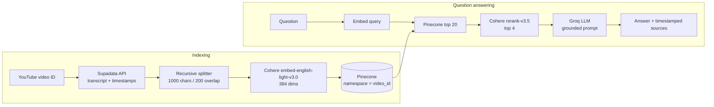

# VidQuery

Chat with any YouTube video. VidQuery fetches a video's transcript, indexes it in a vector database, and answers your questions using only what was said in the video, with timestamped sources that link straight to the moment in the video.

It is a retrieval-augmented generation (RAG) system with a FastAPI backend and a Streamlit frontend.

## Features

- **Grounded answers only.** The LLM is instructed to answer strictly from the retrieved transcript and to say so when the video does not contain the answer.
- **Timestamped sources.** Every answer returns the supporting transcript chunks with start/end times and a `youtube.com/watch?v=...&t=...s` link that jumps to that moment.
- **Two-stage retrieval.** 20 candidate chunks are pulled from Pinecone by vector similarity, then reranked with Cohere and cut to the best 4.
- **Timestamp-aware chunking.** Transcript segments are merged into overlapping chunks while keeping the start and end time of each chunk.
- **Multi-language transcripts.** Choose the transcript language when indexing (UI offers `en`, `hi`, `es`, `fr`, `de`).
- **One namespace per video.** Each video is isolated in its own Pinecone namespace. Re-indexing a video replaces its old vectors.
- **Safe error handling.** Provider failures return a generic `503` or `500` response; internal error details are logged, not leaked to the client.

## How it works



1. **Fetch.** The transcript is requested from [Supadata](https://supadata.ai). If Supadata returns an async job, the backend polls it for up to 120 seconds.
2. **Chunk.** `RecursiveCharacterTextSplitter` builds chunks of 1000 characters with 200 overlap. Each chunk's character range is mapped back to the transcript segments it overlaps, so it gets a `start_time` and `end_time`.
3. **Embed and store.** Chunks are embedded with Cohere (`embed-english-light-v3.0`, 384 dimensions) and uploaded to Pinecone in batches of 16 under the namespace `video_id`, with IDs like `<video_id>-<n>`.
4. **Retrieve and rerank.** A question is embedded, the 20 nearest chunks are fetched, and Cohere `rerank-v3.5` keeps the top 4.
5. **Generate.** The top chunks are passed to a Groq-hosted LLM with timestamps in the context. The prompt forbids outside knowledge and invented timestamps.

## Tech stack

| Layer | Technology |
| --- | --- |
| API | FastAPI, Uvicorn, Pydantic |
| Frontend | Streamlit |
| Transcripts | Supadata |
| Embeddings and reranking | Cohere |
| Vector database | Pinecone |
| LLM | Groq via `langchain-groq` |
| Orchestration | LangChain |
| Testing | pytest, httpx |
| Packaging | uv (Python 3.13+) |

## Project structure

```
.
├── main.py                  # FastAPI app, routers, global error handlers
├── routers/
│   ├── transcript_router.py # /transcript endpoints (fetch, index, search)
│   └── chat_router.py       # /chat/ask endpoint
├── services/
│   ├── transcript.py        # Supadata client with job polling
│   ├── splitter.py          # Timestamp-preserving chunking
│   ├── vector_store.py      # Cohere embeddings + Pinecone indexing
│   ├── retriever.py         # Pinecone retriever (namespace per video)
│   ├── reranker.py          # Cohere rerank + retrieve_and_rerank()
│   └── rag.py               # Prompt, LLM chain, ask_video()
├── schemas/chat.py          # Request validation
├── core/                    # Logging config and custom errors
├── frontend/                # Streamlit app (app.py, api.py)
└── tests/                   # pytest suite
```

## Getting started

### Prerequisites

- Python 3.13+ and [uv](https://docs.astral.sh/uv/)
- API keys for [Supadata](https://supadata.ai), [Cohere](https://cohere.com), [Pinecone](https://www.pinecone.io) and [Groq](https://groq.com)
- A Pinecone index with **dimension 384** (the indexer checks this and fails on a mismatch)

### 1. Install

```bash
git clone https://github.com/raktimava29/YT-chatbot.git
cd YT-chatbot
uv sync
```

Without uv: `pip install -r requirements.txt`, plus `pip install -r frontend/requirements.txt` for the UI.

### 2. Configure the backend

Create a `.env` file in the project root:

```env
SUPADATA_API_KEY=your_supadata_key
COHERE_API_KEY=your_cohere_key
PINECONE_KEY=your_pinecone_key
PINECONE_INDEX_NAME=your_index_name
GROQ_API_KEY=your_groq_key
```

### 3. Run the API

```bash
uv run uvicorn main:app --reload
```

The API runs at `http://localhost:8000`. Interactive docs are at `http://localhost:8000/docs`.

### 4. Run the frontend

Create `.streamlit/secrets.toml` in the project root pointing at your API:

```toml
API_BASE_URL = "http://localhost:8000"
```

Then start Streamlit:

```bash
uv run streamlit run frontend/app.py
```

Open `http://localhost:8501`, paste a YouTube URL, click **Index video**, and start asking questions.

## API reference

| Method | Endpoint | Description |
| --- | --- | --- |
| `GET` | `/` | Health check |
| `POST` | `/transcript/` | Fetch and chunk a transcript without indexing it |
| `POST` | `/transcript/index` | Fetch, chunk, embed and index a transcript |
| `POST` | `/transcript/search` | Plain similarity search over an indexed video |
| `POST` | `/chat/ask` | Ask a question about an indexed video |

### Index a video

```bash
curl -X POST http://localhost:8000/transcript/index \
  -H "Content-Type: application/json" \
  -d '{"video_id": "VMj-3S1tku0", "language": "en"}'
```

```json
{
  "message": "Transcript indexed successfully",
  "video_id": "VMj-3S1tku0",
  "total_chunks": 142
}
```

### Ask a question

```bash
curl -X POST http://localhost:8000/chat/ask \
  -H "Content-Type: application/json" \
  -d '{"video_id": "VMj-3S1tku0", "question": "What is micrograd?"}'
```

```json
{
  "answer": "Micrograd is a small autograd engine ... [00:00:40]",
  "sources": [
    {
      "chunk_id": "VMj-3S1tku0-1",
      "score": 5.2051,
      "content": "...",
      "start_time": 40.64,
      "end_time": 103.28,
      "youtube_url": "https://www.youtube.com/watch?v=VMj-3S1tku0&t=40s"
    }
  ]
}
```

### Error responses

| Status | Meaning |
| --- | --- |
| `422` | Invalid request (missing, empty or whitespace-only `video_id` or `question`) |
| `502` | Transcript provider (Supadata) failed |
| `503` | A dependency (Pinecone, Cohere or Groq) is unavailable |
| `500` | Unexpected server error. The response is always `{"detail": "Internal server error."}` |

`/transcript/search` accepts `video_id`, `query` and `k` (1 to 20, default 4).

## Testing

```bash
uv run pytest tests/test_chat.py tests/test_rag.py
```

The tests mock the retriever and LLM, so they make no network calls. The Groq client is created when the app is imported, so `GROQ_API_KEY` must be set to some value (a dummy one is fine). They cover request validation, timestamp formatting, source metadata, the "not in transcript" fallback, and the guarantee that internal errors are not leaked to clients.

`test_low_reranker_score` currently fails: it expects answers to be skipped when the top rerank score is very low, but `ask_video()` has no score threshold yet.

## Notes and limitations

- The video must be indexed before you can ask questions about it.
- Retrieval quality depends on the transcript. Videos without captions, or with poor auto-generated ones, give weaker answers.
- Embeddings use an English-focused Cohere model, so non-English transcripts may retrieve less accurately.
- The API has no authentication or rate limiting. Add both before exposing it publicly.

## Deployment

The `.devcontainer` config runs the Streamlit frontend in GitHub Codespaces and forwards port 8501. Deploy the FastAPI backend separately on Render and set the environment variables above, and point `API_BASE_URL` in the Streamlit secrets at it.